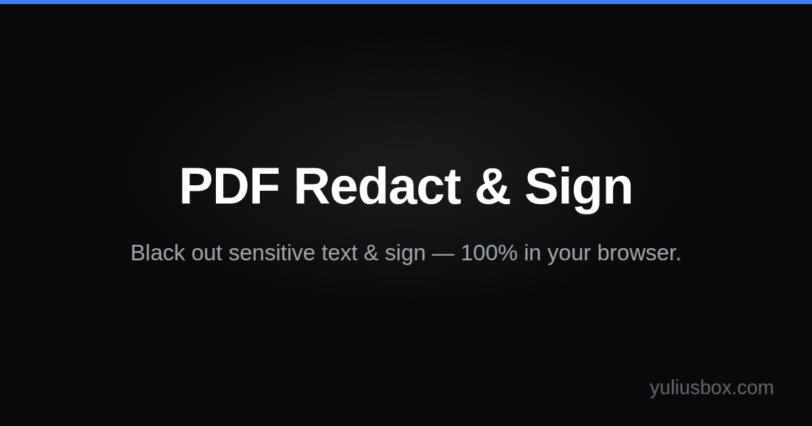
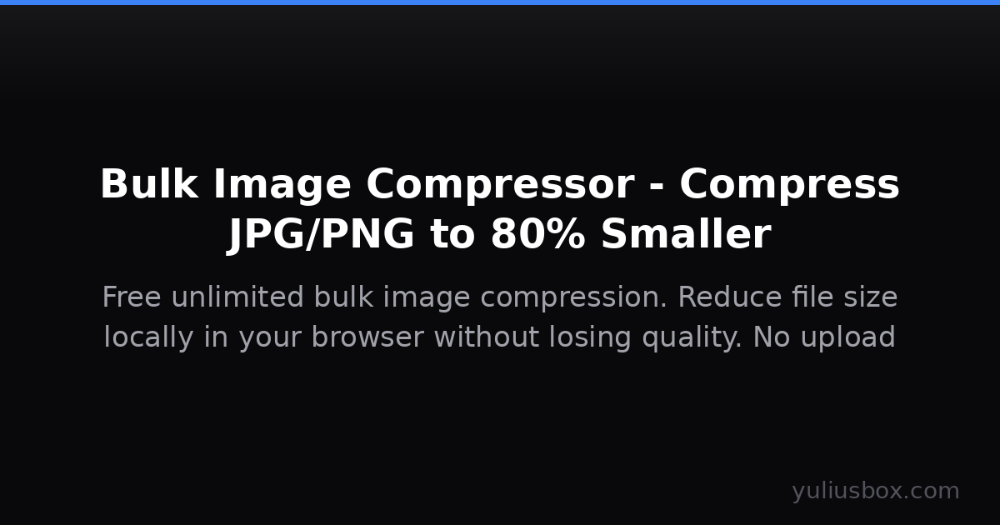

# 🧰 YuliusBox

**Free, privacy-first browser tools — compress images, merge PDFs, remove EXIF, watermark IDs. Most tools run locally; nothing uploaded.**

🌐 Website: [https://www.yuliusbox.com](https://www.yuliusbox.com)

A collection of free, high-performance web utilities built for privacy. Wherever technically possible, processing executes 100% on your client device using modern browser technologies (WebAssembly, HTML5 Canvas, Web Crypto API) — meaning zero bytes of your sensitive documents, photos, or files are ever sent to our servers.

---

## 📸 Overview

<div align="center">
  
</div>

<div align="center" style="display: flex; gap: 10px; justify-content: center; margin-top: 10px;">
  
  
</div>

---

## 🛠️ Tool Matrix: Client-Side vs Server-Processed

We believe in complete transparency about where your data is processed. Tools are classified accurately:

### 🟢 Runs in Browser (100% Client-Side — Zero Uploads)

Your files and data **never leave your device**. You can verify this by checking the DevTools Network tab.

| Tool | Route | Technology | Privacy Description |
| :--- | :--- | :--- | :--- |
| **PDF Redact & Sign** | `/tools/pdf-redact-sign` | PDF.js + pdf-lib | **Verified Irreversible Redaction**: Redacted pages are flattened to 150–200 DPI images with black boxes baked into pixels, permanently destroying underlying text streams and stripping all document metadata. Electronic signatures are drawn or stamped locally. |
| **PDF Toolkit** | `/tools/pdf-kit` | pdf-lib | Merge, split, compress, extract pages, and convert JPG to PDF in browser memory. |
| **Image Compressor** | `/tools/image-compressor` | browser-image-compression | Multi-pass iterative client-side compression for JPG, PNG, and WebP with custom byte targets (e.g., 20KB, 100KB, 1MB). |
| **ID Watermark** | `/tools/id-watermark` | HTML5 Canvas | Stamp purpose-restricted watermarks directly across ID cards and passport photos to deter identity theft. |
| **EXIF Remover** | `/tools/exif-remover` | exifr + Canvas | Inspect hidden metadata and strip EXIF, GPS location, IPTC, and XMP tags. Lossless stripping for JPEGs. |
| **Screenshot Blur** | `/tools/screenshot-blur` | HTML5 Canvas | Blur, pixelate, or black out confidential numbers, emails, and faces in screenshots. |
| **Subtitle Tools** | `/tools/subtitle-tools` | FFmpeg.wasm | Convert between SubRip (SRT) and WebVTT (VTT) formats; hardcode (burn) subtitles directly into MP4 video frames. |
| **Audio to Text** | `/tools/audio-to-text` | Transformers.js (Whisper) | Transcribe speech to text offline in your browser using OpenAI Whisper via WebAssembly / ONNX Runtime Web. |
| **AI Background Remover** | `/tools/background-remover` | @imgly/background-removal | Cut out image backgrounds with client-side neural network segmentation models running on WebAssembly. |
| **Image Grid Splitter** | `/tools/image-grid-splitter` | HTML5 Canvas + JSZip | Slice pictures into 3×3, 3×2, or 3×1 grid tiles with chronological posting-order numbering for Instagram. |
| **Codec Toolbox** | `/tools/codec-toolbox` | Web Crypto API | Base64 encode/decode, SHA-256/SHA-512/MD5 hashing, and Unix epoch timestamp conversion. |
| **JSON to Code** | `/tools/json-to-code` | Client JavaScript | Convert JSON payloads into strongly typed TypeScript interfaces/types, Go structs, or Dart classes. |
| **File Encryptor** | `/tools/file-encryptor` | Web Crypto (AES-GCM) | Encrypt and decrypt any file locally with military-grade AES-256-GCM using client-derived keys. |
| **Text Diff** | `/tools/text-diff` | diff-match-patch | Compare text side-by-side with character and line differences highlighted. |
| **SVG Optimizer** | `/tools/svg-optimizer` | Client XML parser | Minify and clean SVG code locally. |
| **Safe Zone Overlay** | `/tools/safe-zone-overlay` | HTML5 Canvas | Preview video layouts against Instagram Reels, TikTok, and YouTube Shorts UI overlays. |
| **Color Palette** | `/tools/color-palette` | color-thief | Extract dominant color swatches and palettes directly from image pixels. |

### 🟡 Server-Processed (Clearly Disclosed)

These tools require external rendering engines, network queries, or LLM inference. All temporary files are processed in ephemeral containers and immediately discarded:

| Tool | Route | Processing Location | Purpose |
| :--- | :--- | :--- | :--- |
| **Word to PDF** | `/tools/word-to-pdf` | Gotenberg (LibreOffice) | Converts `.docx` documents to high-fidelity PDF vectors on the backend server. |
| **Excel to PDF** | `/tools/excel-to-pdf` | Gotenberg (LibreOffice) | Converts `.xlsx` spreadsheets to PDF on the backend server. |
| **PPT to PDF** | `/tools/ppt-to-pdf` | Gotenberg (LibreOffice) | Converts `.pptx` slides to PDF on the backend server. |
| **URL to PDF** | `/tools/url-to-pdf` | Gotenberg (Chromium) | Captures web pages as PDF documents via headless browser on the server. |
| **Domain Lookup** | `/tools/domain-lookup` | Authoritative RDAP Servers | Queries IANA and registrar RDAP directories for domain registration data. |
| **Excel Formula Bot** | `/tools/excel-formula-bot` | Edge AI API | Generates Excel and Google Sheets formulas from plain English descriptions. |
| **AI Email Paraphraser** | `/tools/email-paraphraser` | Edge AI API | Polishes business emails with custom tone adjustments. |
| **AI Regex Generator** | `/tools/regex-generator` | Edge AI API | Generates regular expressions from human descriptions. |
| **AI Cron Generator** | `/tools/cron-generator` | Edge AI API | Translates schedule descriptions into standard 5-part cron syntax. |
| **Video Downloader** | `/tools/video-downloader` | VPS Worker (yt-dlp) | Resolves public video stream metadata with SSRF protection. |

---

## 🔍 How to Verify Nothing is Uploaded

You don't have to take our word for it — you can verify our privacy claims using your browser's built-in developer tools:

1. Open any **Runs in Browser** tool (such as [Image Compressor](https://www.yuliusbox.com/tools/image-compressor), [ID Watermark](https://www.yuliusbox.com/tools/id-watermark), or [PDF Redact & Sign](https://www.yuliusbox.com/tools/pdf-redact-sign)).
2. Press `F12` (or `Cmd + Option + I` on Mac / `Ctrl + Shift + I` on Windows/Linux) to open **DevTools**.
3. Click the **Network** tab.
4. Click the Clear button (🚫 or ⊘) to clear the request log. Filter by `Fetch/XHR`.
5. Drag and drop your file into the tool and run the operation.
6. **Observe the Network log**: Zero network requests containing your file payload are dispatched. All processing executes strictly inside your computer's browser process and memory.

---

## ⚡ Cross-Tool Handoff (One-Click Chaining)

When working with multi-step document or image workflows, YuliusBox allows passing processed results directly to the next companion tool with a single click:

- **ID Watermark** ➔ **JPG to PDF**: Package watermarked front & back ID photos directly into a PDF application document.
- **EXIF Remover** ➔ **Image Compressor**: Strip metadata, then immediately shrink photo size.
- **Screenshot Blur** ➔ **Image Compressor**: Redact private data, then compress for chat or email.
- **Background Remover** ➔ **Image Compressor**: Cut out transparent PNG, then optimize file size.
- **Image Compressor** ➔ **JPG to PDF**: Optimize pictures, then compile into a PDF booklet.
- **JPG to PDF** ➔ **Merge PDF**: Convert photos to PDF, then merge with existing PDF records.

**Privacy note on handoffs**: Handoffs write temporary Blobs into your local browser's **IndexedDB** using a cryptographically random one-time key. Records auto-expire after 10 minutes and are destroyed immediately upon consumption by the receiving tool. Files are never stored on any server or exposed in URL parameters.

---

## 💻 Tech Stack

- **Framework**: [Next.js 16](https://nextjs.org/) (App Router, Turbopack)
- **UI & Components**: [React 19](https://react.dev/), [Tailwind CSS v4](https://tailwindcss.com/), [Lucide React](https://lucide.dev/)
- **PDF Manipulation**: [pdf-lib](https://pdf-lib.js.org/), [pdfjs-dist](https://mozilla.github.io/pdf.js/)
- **WebAssembly Runtimes**:
  - In-browser Video Processing: [@ffmpeg/ffmpeg](https://github.com/ffmpegwasm/ffmpeg.wasm) (v0.12)
  - In-browser AI Segmentation: [@imgly/background-removal](https://img.ly/)
  - In-browser Speech-to-Text: [@xenova/transformers](https://huggingface.co/docs/transformers.js) (ONNX Runtime Web)
- **Image & Archive Processing**: [browser-image-compression](https://github.com/Donaldcwl/browser-image-compression), [exifr](https://github.com/MikeKovarik/exifr), [jszip](https://stuk.github.io/jszip/)
- **Testing & Verification**: Node.js Native Test Runner, [PyMuPDF](https://pymupdf.readthedocs.io/), [pdfplumber](https://github.com/jsvine/pdfplumber)

---

## 🚀 Getting Started

### Prerequisites

- Node.js 20.9.0+ or Node.js 22+
- npm, pnpm, or bun

### Local Setup

1. **Clone the repository**:
   ```bash
   git clone https://github.com/zeawhy/yuliusbox.git
   cd yuliusbox
   ```

2. **Install dependencies**:
   ```bash
   npm install
   ```

3. **Run local development server**:
   ```bash
   npm run dev
   ```
   Open [http://localhost:3000](http://localhost:3000) to view the site.

4. **Run test suite**:
   ```bash
   npm test
   npm run test:redaction
   ```

5. **Build and validate SEO**:
   ```bash
   npm run build
   # In another terminal:
   npx next start -p 3100
   npm run seo-check
   ```

---

## 🤝 Contributing

Contributions, bug reports, and suggestions are welcome!

1. Fork the repository.
2. Create your feature branch (`git checkout -b feature/amazing-tool`).
3. Commit your changes (`git commit -m 'feat: add amazing tool'`).
4. Ensure tests and SEO checks pass (`npm test`, `npm run seo-check`).
5. Open a Pull Request against `main`.

---

## 📄 License

This project is licensed under the [MIT License](LICENSE).
